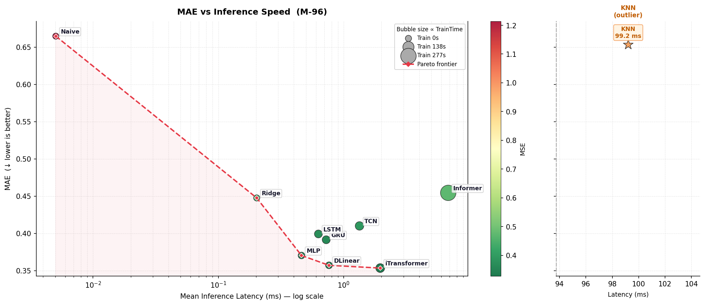
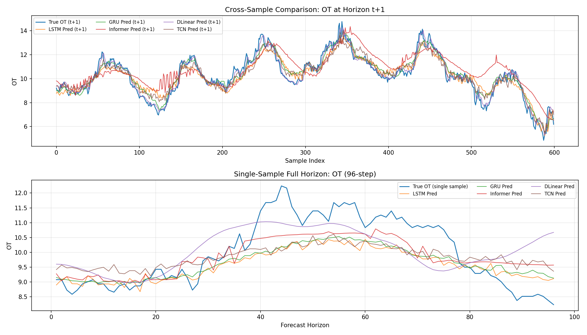
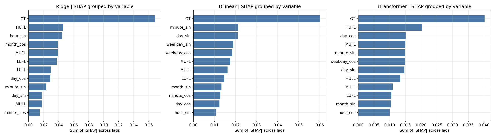
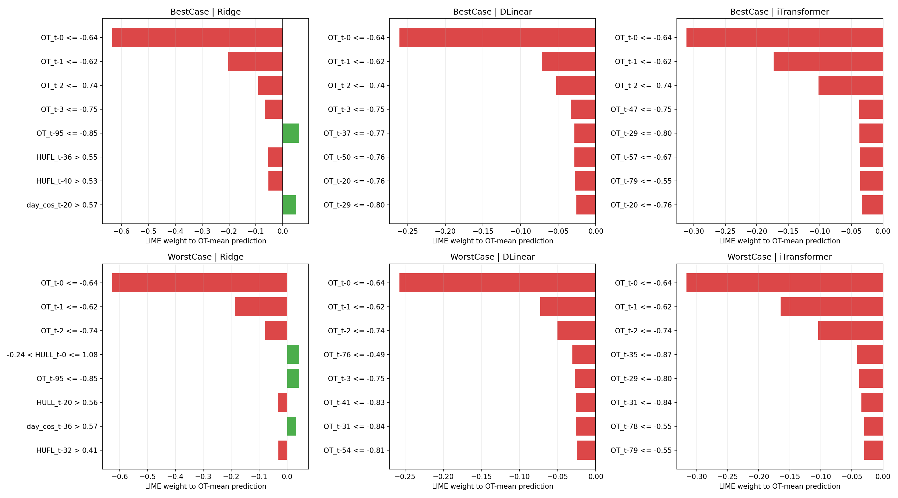
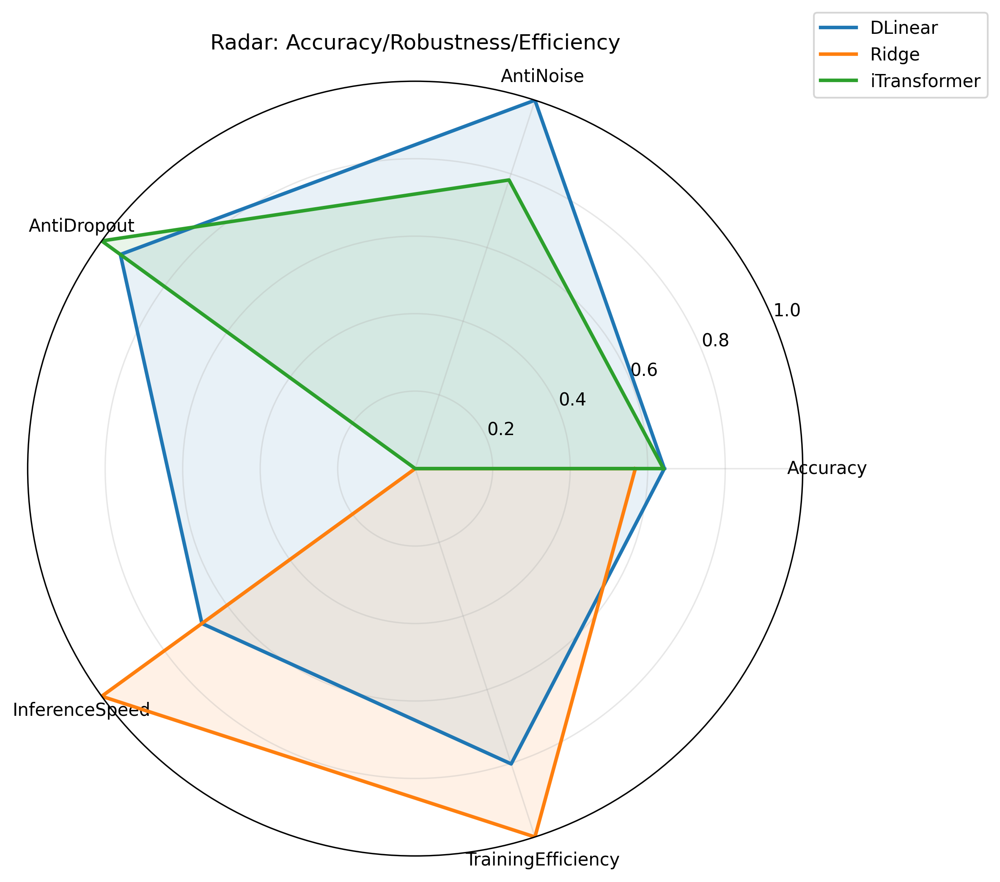

# ETTm1 End-to-End Forecasting Notebook

This notebook implements a full ETTm1 forecasting workflow with standardized splits, metrics, and reporting conventions for reproducible comparison.
It covers data quality checks, feature preparation, baseline and conventional machine models, deep models, interpretability, ablations, robustness tests, and deployment-oriented conclusions.

## Execution Guide (Azure ML)

1. Upload: Place `ettm1_end_to_end.ipynb` and `requirements.txt` in the same Azure working directory.
2. Setup: Open the notebook and select kernel **Python 3.10 - AzureML**.
3. Pass-1 (environment deployment): run until dependency installation finishes (the environment setup/install stage).
4. Restart: restart the kernel immediately after dependencies are installed.
5. Pass-2 (full execution): click **Run All** from the beginning of the notebook.

Expected runtime on an Azure T4 GPU is about **15-20 minutes** end-to-end.

## Execution Guide (Local GPU PC)

Use this flow on a local NVIDIA GPU machine to avoid retaining a CPU-only PyTorch build.

1. Create and activate your Python environment.
2. Install CUDA 12.8 PyTorch wheels first:

```bash
pip install --index-url https://download.pytorch.org/whl/cu128 --extra-index-url https://pypi.org/simple torch torchvision torchaudio
```

3. Install remaining project dependencies:

```bash
pip install -r requirements.txt
```

4. Verify GPU is active:

```bash
python -c "import torch; print(torch.cuda.is_available(), torch.cuda.get_device_name(0) if torch.cuda.is_available() else 'CPU')"
```

5. Open `ettm1_end_to_end.ipynb` and run all cells.

## Dataset Source and License

Dataset source:
- ETTm1 CSV (raw): https://raw.githubusercontent.com/zhouhaoyi/ETDataset/main/ETT-small/ETTm1.csv
- Dataset repository: https://github.com/zhouhaoyi/ETDataset

License:
- **Creative Commons Attribution-NoDerivatives 4.0 International (CC BY-ND 4.0)**
- License link: https://github.com/zhouhaoyi/ETDataset?tab=License-1-ov-file

Citation:
If you find this work useful, please cite the original Informer paper.

<details>
<summary><b>BibTeX Citation (Click to expand)</b></summary>

```bibtex
@inproceedings{haoyietal-informer-2021,
  author    = {Haoyi Zhou and
               Shanghang Zhang and
               Jieqi Peng and
               Shuai Zhang and
               Jianxin Li and
               Hui Xiong and
               Wancai Zhang},
  title     = {Informer: Beyond Efficient Transformer for Long Sequence Time-Series Forecasting},
  booktitle = {The Thirty-Fifth {AAAI} Conference on Artificial Intelligence, {AAAI} 2021, Virtual Conference},
  volume    = {35},
  number    = {12},
  pages     = {11106--11115},
  publisher = {{AAAI} Press},
  year      = {2021},
}
```

</details>

## Table of Contents

1. Data Loading and Setup
2. Exploratory Data Analysis
3. Preprocessing and Feature Engineering
4. Baseline and Conventional Machine Models (with Optuna Tuning)
5. Deep Learning Models (with Optuna Tuning)
6. Model Comparison and Visualization
7. Interpretability and Error Diagnostics
8. Ablation Studies
9. Robustness and Stress Testing
10. Final Conclusions and Deployment Recommendations

## Project Structure

```text
WM9B7-ETTm-Forecasting/
|- ettm1_end_to_end.ipynb
|- ETTm1.csv
|- requirements.txt
|- requirements-gpu-cu128.txt
`- outputs/
   |- configs/
   |- figures/
   |- models/
   |  |- dlinear_best.pt
   |  |- gru_best.pt
   |  |- informer_best.pt
   |  |- itransformer_best.pt
   |  |- lstm_best.pt
   |  |- mlp_best.pt
   |  `- tcn_best.pt
   |- tables/
   |  |- final_metrics_m96.csv
   |  `- final_metrics_table_all_tasks.csv
   |- xai/
   `- _thuml_tsl/
```

Main outputs are written to:
- `outputs/tables/final_metrics_m96.csv`
- `outputs/tables/final_metrics_table_all_tasks.csv`
- `outputs/models/dlinear_best.pt`
- `outputs/models/itransformer_best.pt`
- `outputs/models/`
- `outputs/figures/`
- `outputs/figures/mae_vs_latencymean_tradeoff_m96.png`
- `outputs/figures/dl_prediction_comparison_ot_h1_and_96step.png`
- `outputs/figures/radar_accuracy_robustness_efficiency.png`
- `outputs/configs/`
- `outputs/xai/`
- `outputs/xai/xai_shap_grouped_by_variable_three_models.png`
- `outputs/xai/xai_lime_local_extreme_windows_three_models.png`

## Evidence-Based Results Summary

### 1) Main benchmark (M-96)

Model-by-model metrics (from `outputs/tables/final_metrics_m96.csv`):

| Model | MAE | RMSE | TrainTimeSec | LatencyP95Ms | SkillScore_MAE (%) | EnergyKWh | CO2g |
|---|---:|---:|---:|---:|---:|---:|---:|
| iTransformer | 0.353577 | 0.572823 | 54.724 | 2.618 | 46.81 | 0.003800 | 1.8051 |
| DLinear | 0.357292 | 0.581423 | 11.489 | 0.833 | 46.25 | 0.000798 | 0.3790 |
| MLP | 0.370468 | 0.583729 | 8.867 | 0.511 | 44.27 | 0.000616 | 0.2925 |
| GRU | 0.391567 | 0.599696 | 34.434 | 0.931 | 41.10 | 0.002391 | 1.1358 |
| LSTM | 0.399354 | 0.609593 | 33.371 | 0.696 | 39.93 | 0.002317 | 1.1008 |
| TCN | 0.410137 | 0.627247 | 47.477 | 1.634 | 38.31 | 0.003297 | 1.5661 |
| Ridge | 0.447693 | 0.661516 | 0.793 | 0.309 | 32.66 | 0.000055 | 0.0262 |
| Informer | 0.454480 | 0.686030 | 276.864 | 7.643 | 31.63 | 0.019227 | 9.1327 |
| KNN | 0.653379 | 0.872125 | 0.045 | 105.682 | 1.72 | 0.000003 | 0.0015 |
| Naive | 0.664785 | 1.101770 | 0.009 | 0.005 | 0.00 | 0.000001 | 0.0003 |

Note: Energy and carbon estimates are heuristic and intended for relative comparison, not precise accounting.

Calibrated conclusions:
- Accuracy leader: **iTransformer** (best MAE/MSE/RMSE and highest SkillScore 46.81%).
- Efficiency-accuracy balance: **DLinear** has second-best MAE (0.357292) with much lower TrainTimeSec (11.489 vs 54.724) and lower CO2g (0.3790 vs 1.8051) than iTransformer.
- Operational caution: **KNN** is the only latency non-compliant model (P95 105.682 ms > 50 ms threshold).
- Total M-96 footprint across the benchmark set: **468.07s**, **0.032505 kWh**, **15.4400 g CO2e** (heuristic estimate for relative comparison).

### 2) Interpretability signals

- Ridge coefficient analysis and SHAP both identify **OT** as the strongest predictor group.
- iTransformer grouped SHAP shows mixed reliance on physical and temporal features, indicating balanced use rather than single-source dependence.
- LIME local explanations show a stable dominant rule pattern around recent OT lags (for example, `OT_t-0`), consistent across best/worst sample cases.

### 3) Ablation studies (Phase 8)

- Horizon ablation (PredLen = 24/48/96/288/672):
  - At short horizon (24), **iTransformer** has the best MAE (**0.297591**), followed by DLinear (**0.305010**) and Ridge (**0.339837**).
  - At medium horizon (96), **iTransformer** is best (MAE **0.355024**), followed by DLinear (**0.356503**) and Ridge (**0.448848**).
  - At long horizon (672), **DLinear** is best on MAE (**0.434631**), followed by iTransformer (**0.439606**) and Ridge (**0.586829**).
  - OT-specific error at 672 is nearly tied for DLinear and iTransformer (**0.217878** vs **0.218181**), and both are lower than Ridge (**0.273883**).

- Coupling-mode ablation (M7->M7, M7->OT1, OT1->OT1):
  - DLinear: OT_MAE improves from **0.139144** (M7->M7) to **0.126965** (M7->OT1), and further to **0.126899** (OT1->OT1).
  - Ridge: OT1->OT1 gives the strongest gain, OT_MAE **0.130333** (about **21.91%** better than Ridge M7->OT1).
  - iTransformer: M7->OT1 OT_MAE (**0.127537**) is slightly better than OT1->OT1 (**0.127729**), indicating it still benefits from multivariate context.

- Sequence-length ablation (SeqLen = 48/96/192, PredLen = 96):
  - DLinear MAE improves at SeqLen 192 (**0.340169**) vs SeqLen 96 (**0.357090**), while OT_MAE is slightly higher (**0.139024** vs **0.138589**).
  - Ridge MAE improves at SeqLen 192 (**0.404294**) vs 96 (**0.448848**), but OT_MAE degrades (**0.158695** vs **0.152506**).
  - iTransformer improves on both MAE and OT_MAE at SeqLen 192 (**0.344283**, **0.136911**) vs 96 (**0.354880**, **0.139131**).

- Token-strategy ablation (iTransformer):
  - Best MAE setting is **VToken-Original** (MAE **0.354818**, OT_MAE **0.139579**).
  - **VToken-GroupedLoad** has slightly worse MAE (**0.356737**) but slightly better OT_MAE (**0.138875**).
  - **TToken-Proxy** is substantially worse (MAE **0.512820**, OT_MAE **0.156712**), so it should not be used for strict comparison/deployment.

### 4) Stress testing (Phase 9)

- Gaussian noise stress (NoiseStd up to 0.20):
  - DLinear: MAE delta **+2.61%**, OT_MAE delta **+12.60%**.
  - iTransformer: MAE delta **+2.99%**, OT_MAE delta **+21.42%**.
  - Ridge: MAE delta **+22.55%**, OT_MAE delta **+48.04%**.
  - Conclusion: DLinear and iTransformer are both relatively stable in MAE under noise; DLinear has lower OT_MAE degradation.

- Data dropout stress (DropoutRate up to 0.40):
  - At 0.20 dropout, MAE deltas are DLinear **+13.84%**, iTransformer **+13.68%**, Ridge **+39.33%**.
  - At 0.40 dropout, MAE deltas are DLinear **+34.86%**, iTransformer **+33.23%**, Ridge **+61.99%**.
  - OT_MAE degradation is substantial at high dropout for all models; at 0.40 dropout, DLinear is lowest (**0.540554**) vs iTransformer (**0.545264**) and Ridge (**0.619496**).
  - Conclusion: dropout causes larger degradation than Gaussian noise for all three models, and DLinear retains the lowest OT_MAE at high dropout.

## Results Snapshots

### Accuracy-Latency Trade-off (M-96)



### Multi-Model Prediction Comparison (OT, h=1 and 96-step)



### SHAP Grouped Importance (Ridge, DLinear, iTransformer)



### LIME Local Explanations (Best/Worst Windows)



## Final Concise Deployment Conclusion

- Primary model: **DLinear**.
- Quality fallback model: **iTransformer**.
- Emergency fallback model (resource-failure mode): **Ridge**.
- Primary online metric: **OT_MAE** (cross-mode fair metric).
- Decision basis: balanced consideration of MAE/OT_MAE, robustness under noise/dropout, latency, and training efficiency.
- Note on scoring perspective: the notebook's final evidence table is multi-objective; quality fallback selection prioritizes forecast quality under normal resources, while emergency fallback prioritizes survivability under resource failure.

Deployment recommendations:
1. Deploy DLinear as primary.
2. Switch to iTransformer when OT_MAE shows sustained degradation under normal resource status.
3. Switch to Ridge when GPU/service resources are unavailable or unstable.
4. Trigger retraining when OT_MAE rolling mean degrades by more than 10% for 7 consecutive days.
5. Use canary rollout (5-10% traffic) before full production release.

Deployment decision radar (from notebook final evaluation):

