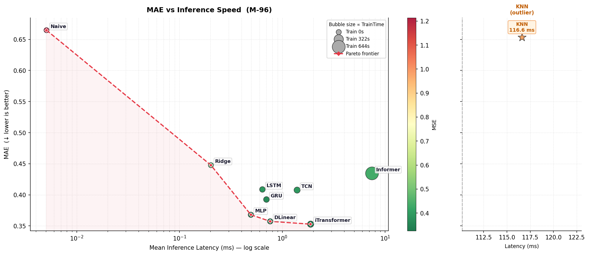
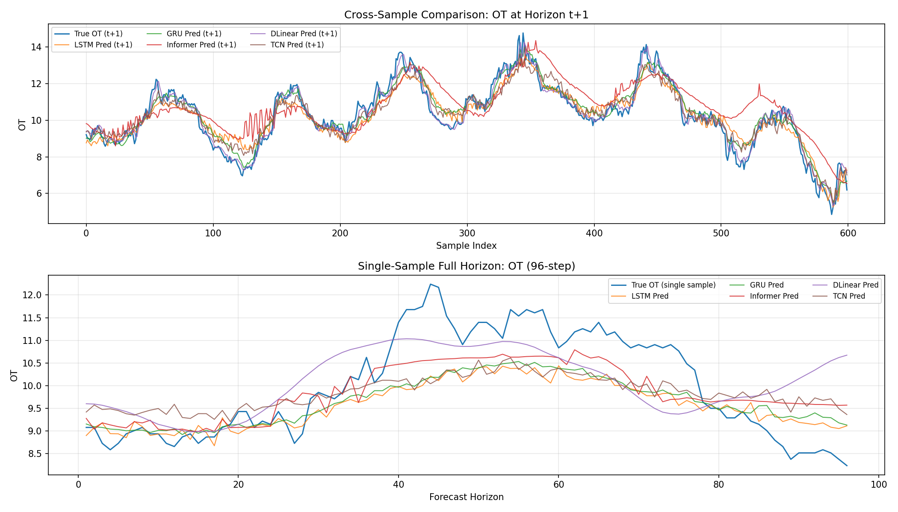
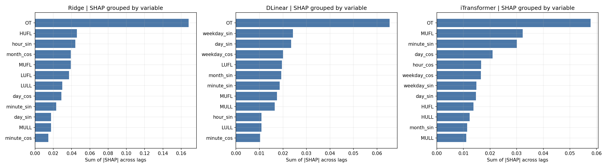
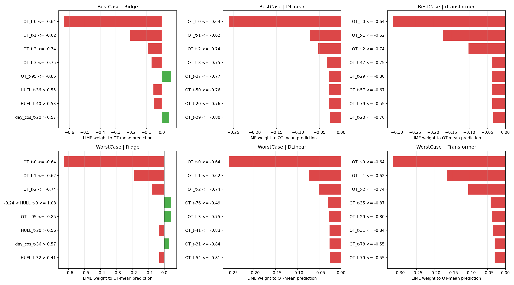
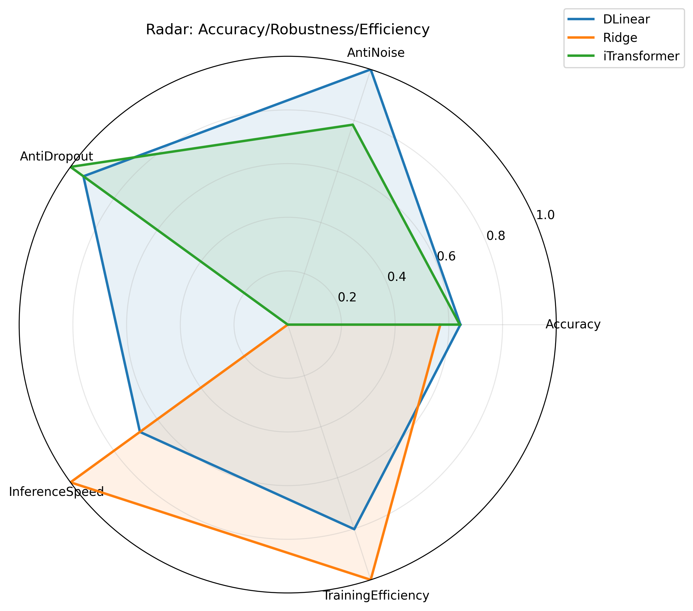

<a id="top"></a>

<div align="center">

<h1>ETTm1 时间序列预测</h1>

<p><strong>从变压器负荷数据出发，完成有据可依的预测模型选择。</strong></p>
<p>十大模型 · 统一评估协议 · 精度、效率与鲁棒性</p>

<p>
  
  
  
  
</p>

<p>
  <a href="README.md"></a>
  <a href="README.zh-CN.md"></a>
</p>

<p>
  <a href="ettm1_end_to_end.ipynb"><strong>打开 Notebook</strong></a> ·
  <a href="#quick-start"><strong>快速开始</strong></a> ·
  <a href="#results"><strong>基准结果</strong></a> ·
  <a href="#artifacts"><strong>浏览产物</strong></a>
</p>

</div>

---

<a id="overview"></a>

## 项目概览

本项目通过一个可执行的 [Jupyter Notebook](ettm1_end_to_end.ipynb)，串联 ETTm1 数据校验、时间特征构建、模型调优、基准评估、可解释性分析、消融实验与压力测试。项目将预测精度与训练成本、推理延迟、输入鲁棒性联系起来，为时间序列预测提供完整的模型选择依据。

| 基准精度最佳 | 推荐主模型 | 快速资源兜底 |
| :--- | :--- | :--- |
| **iTransformer** · MAE **0.353577** | **DLinear** · P95 **0.833 ms** | **Ridge** · P95 **0.309 ms** |
| 相比 Naive，MAE 降低 **46.81%** | 基准训练时间 **11.489 s** | 基准训练时间 **0.793 s** |



**页面导航：** [快速开始](#quick-start) · [实验协议](#protocol) · [基准结果](#results) · [实验分析](#experiments) · [产物索引](#artifacts) · [模型选择](#deployment) · [数据与参考](#references)

<a id="quick-start"></a>

## 快速开始

### 本地环境

复现已记录的本地环境时，使用 **Python 3.13**、**Git**，并选择项目环境中的 Jupyter kernel。Notebook 执行时从 `raw.githubusercontent.com` 读取 ETTm1，并从 GitHub 克隆 THUML Time-Series-Library。

```bash
git clone https://github.com/Zayne-Feng/ETTm-Forecasting.git
cd ETTm-Forecasting
```

在 Windows PowerShell 中创建并激活环境：

```powershell
py -3.13 -m venv .venv
.\.venv\Scripts\Activate.ps1
python -m pip install --upgrade pip
```

<details>
<summary><strong>Linux / macOS 环境命令</strong></summary>

```bash
python3.13 -m venv .venv
source .venv/bin/activate
python -m pip install --upgrade pip
```

</details>

使用 **NVIDIA GPU** 时，先安装 CUDA 12.8 对应的 PyTorch 包，再安装项目依赖：

```bash
python -m pip install -r requirements-gpu-cu128.txt
python -m pip install -r requirements.txt
```

使用 **CPU** 时，安装项目依赖：

```bash
python -m pip install -r requirements.txt
```

注册 kernel 并打开 Jupyter：

```bash
python -m ipykernel install --user --name ettm --display-name "Python (ETTm)"
python -m jupyter notebook ettm1_end_to_end.ipynb
```

选择 **Python (ETTm)**，先运行第一个代码单元格安装并检查依赖，重启 kernel 后执行 **Run All**。Notebook 自动选择可用的 CUDA 设备，否则使用 CPU。

```bash
python -c "import torch; print('PyTorch:', torch.__version__); print('CUDA available:', torch.cuda.is_available()); print('Device:', torch.cuda.get_device_name(0) if torch.cuda.is_available() else 'CPU')"
```

### Azure ML

1. 将 `ettm1_end_to_end.ipynb` 与 `requirements.txt` 上传到同一工作目录。
2. 按 Notebook 中的 Azure 执行指南，选择 **Python 3.10 - AzureML** kernel。
3. 运行依赖安装单元格，重启 kernel 后执行 **Run All**。

<details>
<summary><strong>Notebook 已保存的运行环境</strong></summary>

| 组件 | 记录值 |
| :--- | :--- |
| Python | 3.13.12 |
| PyTorch | 2.11.0+cu128 |
| CUDA | 12.8 |
| GPU | NVIDIA GeForce GTX 1650 Ti |
| NumPy / pandas | 2.4.4 / 3.0.2 |
| scikit-learn / Optuna | 1.8.0 / 4.8.0 |
| SHAP / LIME | 0.51.0 / 0.2.0.1 |

基准表记录的各模型训练时间合计为 **468.07 s**，由 `TrainTimeSec` 列求和得到；调优、可解释性分析、消融与压力测试属于独立阶段。

</details>

<a id="protocol"></a>

## 实验协议

| 项目 | 配置 |
| :--- | :--- |
| 数据 | **69,680** 条观测，采样间隔 **15 分钟**；2016-07-01 至 2018-06-26 |
| 物理变量 | `HUFL`、`HULL`、`MUFL`、`MULL`、`LUFL`、`LULL`、`OT` |
| 主任务 | **M-96**：使用过去 96 步预测未来 96 步的全部七个变量，即 **24 小时 → 24 小时** |
| 输入特征 | 七个物理变量 + 十个日历正余弦特征，共 **17 个通道** |
| 时间划分 | 按每月 30 天构造 **12 / 4 / 4** 月区间；训练 `[0, 34560)`、验证 `[34560, 46080)`、测试 `[46080, 57600)` |
| 滑动窗口数 | 训练 **34,369**、验证 **11,425**、测试 **11,425** |
| 标准化 | `StandardScaler` 在训练集上拟合；验证与测试输入包含此前的历史上下文 |
| 精度指标 | MAE、MSE、RMSE 在**标准化目标空间**计算；Notebook 同时展示反标准化后的逐变量指标 |
| Skill score | `100 × (1 − 模型 MAE / Naive MAE)` |
| 延迟 | 单个窗口推理，记录均值、中位数与 P95；比较阈值为 **P95 < 50 ms** |
| 随机种子 | **42** |

Notebook 检查时间戳连续性、重复时间戳、缺失值、张量有限性与标签边界。已保存的数据检查结果显示：缺失值为零，15 分钟时间戳完整连续。

### 模型与实现来源

| 类型 | 模型 | 实现 |
| :--- | :--- | :--- |
| 基线模型 | Naive、Ridge、KNN | 最后观测值重复；scikit-learn 回归器 |
| 循环网络 | LSTM、GRU | 本地 PyTorch 实现 |
| 时间序列架构 | Informer、DLinear、iTransformer | THUML Time-Series-Library 适配器 |
| 卷积网络 | TCN | `pytorch-tcn` 适配器 |
| 前馈网络 | MLP | `torchvision.ops.MLP` 适配器 |

Optuna 根据验证集表现调优 Ridge、KNN 与七个深度学习模型。深度学习流程包含 RevIN、输入噪声、梯度裁剪、混合精度和各模型的训练配置。

<details>
<summary><strong>Notebook 的十个连续阶段</strong></summary>

| 阶段 | 主要产物 |
| :--- | :--- |
| 1. 数据加载与设置 | 运行配置、数据指纹与完整性检查 |
| 2. 探索性数据分析 | 趋势、分布、ADF 检验、STL、相关性与滞后结构 |
| 3. 预处理 | 周期特征、时间划分、标准化与滑动窗口 |
| 4. 传统模型 | Naive、Ridge、KNN 基准及 Optuna 调优 |
| 5. 深度学习 | 七个模型的训练、权重、损失曲线与预测 |
| 6. 模型比较 | 统一指标表与精度—延迟 Pareto 视图 |
| 7. 可解释性 | Ridge 系数、SHAP 与 LIME |
| 8. 消融实验 | 预测长度、变量耦合、上下文长度与 token 策略 |
| 9. 鲁棒性 | 高斯输入噪声与时间点数据丢弃 |
| 10. 模型选择 | 精度、鲁棒性、效率评分与部署建议 |

</details>

<a id="results"></a>

## 基准结果

**M-96 · 标准化目标 · 按 MAE 升序排列。** 数值来自 [`final_metrics_m96.csv`](outputs/tables/final_metrics_m96.csv) 与 Notebook 保存的比较结果。

| 模型 | MAE ↓ | RMSE ↓ | 训练时间（s）↓ | P95 延迟（ms）↓ | Skill score（%）↑ |
| :--- | ---: | ---: | ---: | ---: | ---: |
| **iTransformer** | **0.353577** | **0.572823** | 54.724 | 2.618 | **46.81** |
| **DLinear** | 0.357292 | 0.581423 | 11.489 | 0.833 | 46.25 |
| MLP | 0.370468 | 0.583729 | 8.867 | 0.511 | 44.27 |
| GRU | 0.391567 | 0.599696 | 34.434 | 0.931 | 41.10 |
| LSTM | 0.399354 | 0.609593 | 33.371 | 0.696 | 39.93 |
| TCN | 0.410137 | 0.627247 | 47.477 | 1.634 | 38.31 |
| Ridge | 0.447693 | 0.661516 | 0.793 | 0.309 | 32.66 |
| Informer | 0.454480 | 0.686030 | 276.864 | 7.643 | 31.63 |
| KNN | 0.653379 | 0.872125 | 0.045 | 105.682 | 1.72 |
| Naive | 0.664785 | 1.101770 | 0.009 | 0.005 | 0.00 |

**iTransformer 在精度基准中领先；DLinear 以接近最优的精度，兼顾更低的训练成本与推理延迟。** 九个模型满足 50 ms 的 P95 目标，KNN 的 P95 为 105.682 ms。

<details>
<summary><strong>训练能耗与碳排放估算</strong></summary>

Notebook 使用公式 `EnergyKWh = TrainTimeSec / 3600 × POWER_KW`，以及 `CO2g = EnergyKWh × 0.475 × 1000`。已保存的 CUDA 运行使用 `POWER_KW = 0.25`，CPU 分支使用 `0.065`。

| 模型 | 估算能耗（kWh） | 估算 CO₂e（g） |
| :--- | ---: | ---: |
| iTransformer | 0.003800 | 1.8051 |
| DLinear | 0.000798 | 0.3790 |
| MLP | 0.000616 | 0.2925 |
| GRU | 0.002391 | 1.1358 |
| LSTM | 0.002317 | 1.1008 |
| TCN | 0.003297 | 1.5661 |
| Ridge | 0.000055 | 0.0262 |
| Informer | 0.019227 | 9.1327 |
| KNN | 0.000003 | 0.0015 |
| Naive | 0.000001 | 0.0003 |
| **合计** | **0.032505** | **15.4400** |

</details>

### 预测效果

Notebook 展示 OT 在第一个预测步上的表现，以及完整 96 步窗口内的预测轨迹。



<a id="experiments"></a>

## 消融、鲁棒性与可解释性

### 预测长度

固定输入长度为 96 步时，iTransformer 在 24、48、96、288 步预测中取得最低整体 MAE；DLinear 在 672 步预测中领先。

| 预测步数 | 对应时长 | Ridge MAE | DLinear MAE | iTransformer MAE |
| ---: | :--- | ---: | ---: | ---: |
| 24 | 6 小时 | 0.339837 | 0.305010 | **0.297591** |
| 48 | 12 小时 | 0.409320 | 0.340102 | **0.334241** |
| 96 | 24 小时 | 0.448848 | 0.356503 | **0.355024** |
| 288 | 72 小时 | 0.502443 | 0.393802 | **0.393112** |
| 672 | 7 天 | 0.586829 | **0.434631** | 0.439606 |

### 变量耦合、上下文与 token 策略

| 实验 | 设置 | 结果 |
| :--- | :--- | :--- |
| 变量耦合 | `M7→M7`、`M7→OT1`、`OT1→OT1`；使用物理输入 | DLinear 的 OT_MAE 为 **0.139144 → 0.126965 → 0.126899**。Ridge 在 `OT1→OT1` 下达到 **0.130333**；iTransformer 在 `M7→OT1` 下达到 **0.127537**。 |
| 上下文长度 | 输入 48 / 96 / 192 步，固定预测 96 步 | 输入 192 步时，DLinear、Ridge、iTransformer 的 MAE 分别为 **0.340169**、**0.404294**、**0.344283**。 |
| Token 策略 | `VToken-Original`、`VToken-GroupedLoad`、`TToken-Proxy` | 原始变量 token 的 MAE 最低，为 **0.354818**；负荷分组 token 的 OT_MAE 最低，为 **0.138875**；时间 token 代理架构的 MAE 为 **0.512820**。 |

耦合实验采用 **OT_MAE** 比较三种模式对同一油温目标的标准化预测误差。Token 实验使用独立的时间 token 代理架构；负荷分组变体额外增加三个负荷分组辅助通道。

<details>
<summary><strong>OT 误差与上下文长度明细</strong></summary>

预测 672 步时，DLinear 与 iTransformer 的 OT_MAE 分别为 **0.217878** 和 **0.218181**，Ridge 为 **0.273883**。

| 模型 | MAE，输入 96 步 | MAE，输入 192 步 | OT_MAE，输入 96 步 | OT_MAE，输入 192 步 |
| :--- | ---: | ---: | ---: | ---: |
| DLinear | 0.357090 | 0.340169 | 0.138589 | 0.139024 |
| Ridge | 0.448848 | 0.404294 | 0.152506 | 0.158695 |
| iTransformer | 0.354880 | 0.344283 | 0.139131 | 0.136911 |

</details>

### 输入鲁棒性

高斯压力测试在输入张量上加入标准差为 `0 / 0.01 / 0.05 / 0.10 / 0.20` 的噪声。时间点丢弃测试以 `0 / 0.05 / 0.10 / 0.20 / 0.40` 的比例随机选择输入时间点，将该时间点的全部通道置零。各实验均相对自身的零扰动基线计算变化率。

| 模型 | 噪声 σ = 0.20 时 MAE 增幅 | 噪声 σ = 0.20 时 OT_MAE 增幅 | 丢弃 40% 时 MAE 增幅 | 丢弃 40% 时 OT_MAE |
| :--- | ---: | ---: | ---: | ---: |
| **DLinear** | **+2.61%** | **+12.60%** | +34.86% | **0.540554** |
| iTransformer | +2.99% | +21.42% | **+33.23%** | 0.545264 |
| Ridge | +22.55% | +48.04% | +61.99% | 0.619496 |

在这两类扰动下，DLinear 与 iTransformer 的整体预测精度均优于 Ridge。DLinear 在 40% 丢弃率下的 OT_MAE 最低，在噪声 σ = 0.20 时的 OT_MAE 增幅最小。

### 模型解释

Ridge 将系数重要性前 20 的特征按基础变量分组后，**OT** 排在首位；iTransformer 的分组 SHAP 也将 OT 排在首位，其绝对归因占比为 **18.04%**，其余贡献分布于物理变量与日历特征。SHAP 解释跨目标变量、跨预测步的标准化预测均值；LIME 解释预测窗口内的 OT 均值。在按 iTransformer 误差选出的最佳与最差窗口中，三个模型的首要 LIME 规则均与 `OT_t-0` 有关。

<details>
<summary><strong>查看 SHAP 与 LIME 图表</strong></summary>





</details>

<a id="artifacts"></a>

## 项目结构与产物索引

```text
ETTm-Forecasting/
├── README.md
├── README.zh-CN.md
├── ettm1_end_to_end.ipynb
├── requirements.txt
├── requirements-gpu-cu128.txt
└── outputs/
    ├── configs/      # Experiment and tuning configurations
    ├── figures/      # EDA, predictions, loss curves and comparison plots
    ├── models/       # Seven PyTorch state_dict checkpoints
    ├── tables/       # Benchmark CSV exports
    └── xai/          # SHAP and LIME figures
```

执行时还会在项目根目录创建 `ETTm1.csv`，并在 `outputs/_thuml_tsl/Time-Series-Library/` 中获取模型源码。

| 产物 | 内容 |
| :--- | :--- |
| [Notebook](ettm1_end_to_end.ipynb) | 可执行流程、已保存输出及完整消融和压力测试结果表 |
| [全局配置](outputs/configs/config.json) | 随机种子、数据划分、窗口、模型与优化设置 |
| [最优深度学习配置](outputs/configs/best_config_dl.json) | 七个深度模型的 Optuna 调优结果 |
| [M-96 基准表](outputs/tables/final_metrics_m96.csv) | 精度、训练时间、延迟、skill score 及估算能耗与碳排放 |
| [模型指标汇总](outputs/tables/final_metrics_table_all_tasks.csv) | 主比较阶段收集的各次模型运行核心指标 |
| [模型权重](outputs/models/) | `dlinear_best.pt`、`gru_best.pt`、`informer_best.pt`、`itransformer_best.pt`、`lstm_best.pt`、`mlp_best.pt`、`tcn_best.pt` |
| [损失曲线](outputs/figures/dl_loss_curves_all_models.png) | 深度模型的训练与验证损失 |
| [解释图表](outputs/xai/) | 分组归因、时间归因与局部解释 |

<a id="deployment"></a>

## 模型选择与部署建议

Notebook 的最终决策综合预测精度、抗噪声、抗数据丢弃、推理速度与训练效率五个维度。

最终评分为五项得分的等权均值。精度项使用 `M7→M7` 耦合实验的 `1 − CleanMAE`；鲁棒性项使用 OT_MAE 随噪声水平、丢弃率变化的斜率；效率项使用平均推理延迟与训练时间。鲁棒性与效率的四项得分在三个候选模型之间进行 min–max 归一化，斜率、延迟、训练时间越低，得分越高。

| 角色 | 模型 | 选择依据 |
| :--- | :--- | :--- |
| **主模型** | **DLinear** | 五维综合评分最高，为 **0.813064**，兼顾低误差、输入鲁棒性和训练推理效率 |
| **质量备选** | **iTransformer** | 在最终决策表的其余候选中，干净数据 MAE 最低；同时取得主基准的最佳精度 |
| **资源兜底** | **Ridge** | 在其余候选中推理延迟最低，并采用轻量级 CPU 回归器 |

五维综合评分分别为：DLinear **0.813064**、Ridge **0.513619**、iTransformer **0.484785**。质量备选依据干净数据 MAE 选择，资源兜底依据延迟选择。

1. 以 **DLinear** 作为主预测模型，以 **OT_MAE** 作为主要在线质量指标。
2. 资源正常且 OT_MAE 持续退化时，选择 **iTransformer**。
3. GPU 或服务资源不可用时，选择 **Ridge**。
4. OT_MAE 滚动均值连续 **7 天**上升超过 **10%** 时触发重训练。
5. 上线从 **5–10%** 流量的灰度发布开始。

以上为 Notebook 最后一节给出的模型选择与运行建议。



<a id="references"></a>

## 数据与参考

- **数据集：** [ETDataset](https://github.com/zhouhaoyi/ETDataset) · [ETTm1 CSV](https://raw.githubusercontent.com/zhouhaoyi/ETDataset/main/ETT-small/ETTm1.csv)
- **数据集许可证：** [Creative Commons Attribution-NoDerivatives 4.0 International](https://github.com/zhouhaoyi/ETDataset/blob/main/LICENSE)
- **时间序列模型实现：** [THUML Time-Series-Library](https://github.com/thuml/Time-Series-Library)
- **主要依赖：** PyTorch、scikit-learn、Optuna、statsmodels、SHAP、LIME、`pytorch-tcn` 与 torchvision

<details>
<summary><strong>数据集引用 · BibTeX</strong></summary>

```bibtex
@inproceedings{haoyietal-informer-2021,
  author    = {Haoyi Zhou and
               Shanghang Zhang and
               Jieqi Peng and
               Shuai Zhang and
               Jianxin Li and
               Hui Xiong and
               Wancai Zhang},
  title     = {Informer: Beyond Efficient Transformer for Long Sequence Time-Series Forecasting},
  booktitle = {The Thirty-Fifth {AAAI} Conference on Artificial Intelligence, {AAAI} 2021, Virtual Conference},
  volume    = {35},
  number    = {12},
  pages     = {11106--11115},
  publisher = {{AAAI} Press},
  year      = {2021}
}
```

</details>

---

<div align="center">
  <a href="#top">返回顶部 ↑</a> · <a href="README.md">English</a> · <a href="ettm1_end_to_end.ipynb">阅读 Notebook →</a>
</div>
